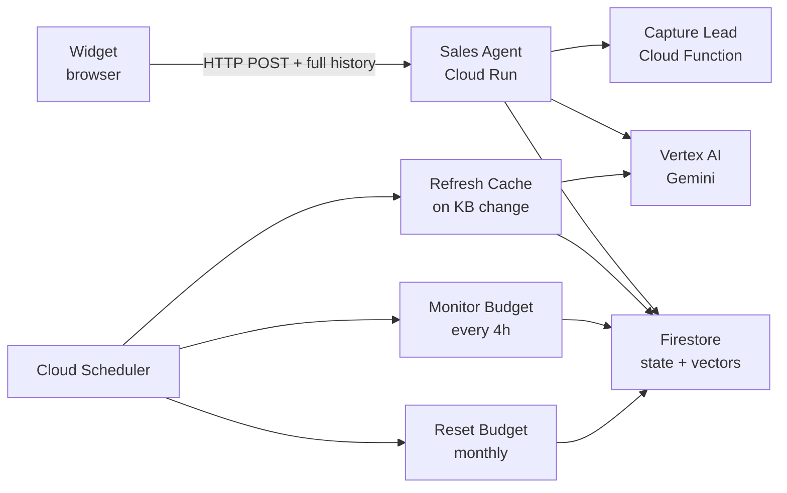
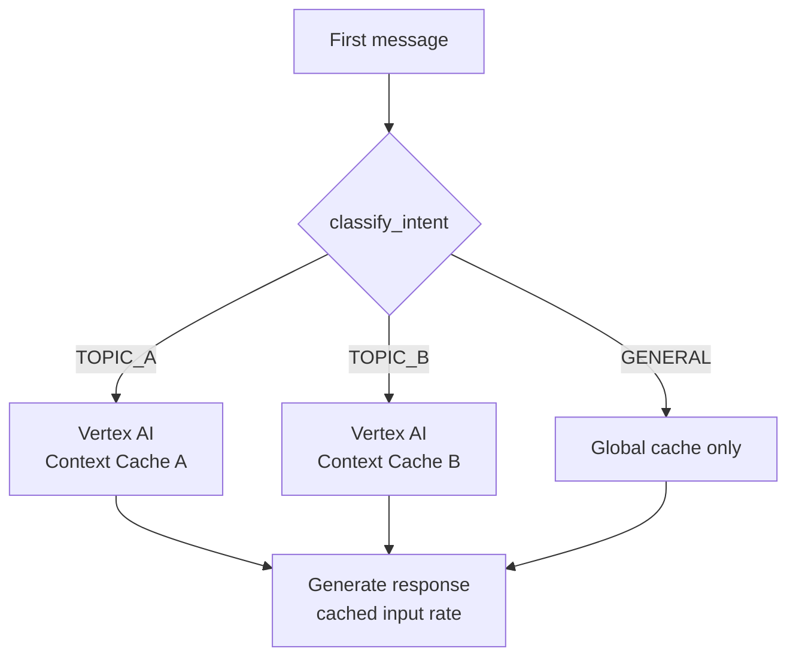
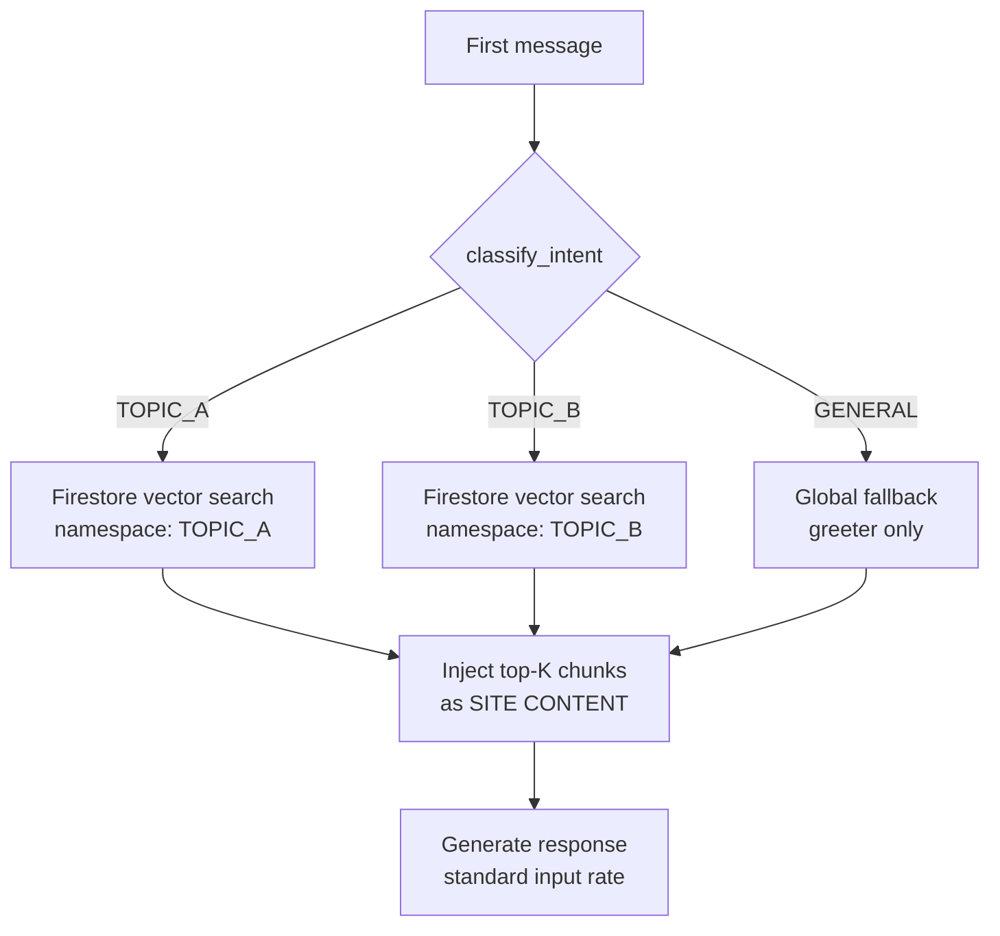
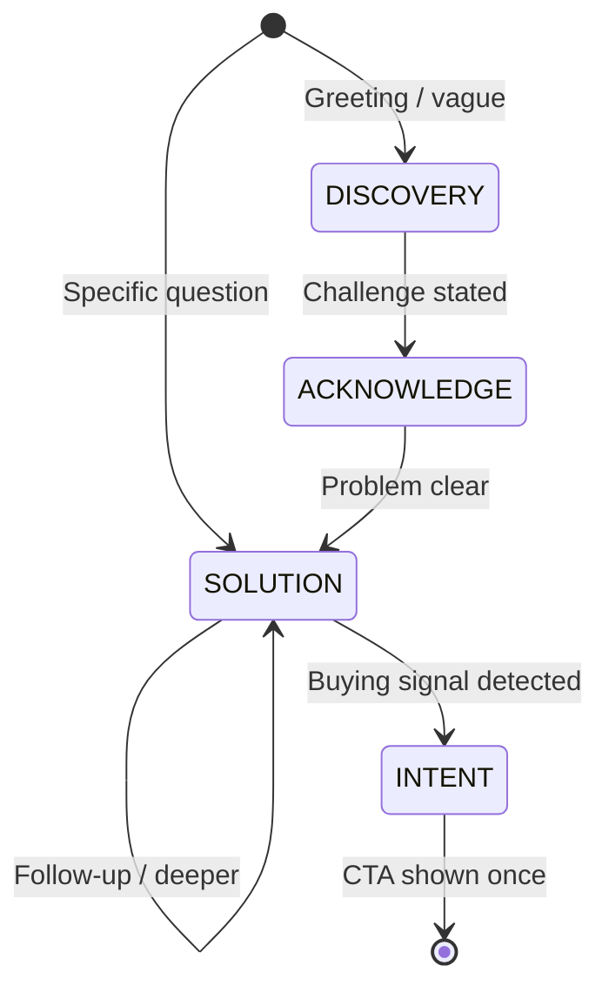

# Site Sales Agent

Production-grade AI sales agent with built-in budget governance, behavioral guardrails, and security — open source under MIT.

A conversational AI that handles inbound sales conversations on a website with the same rigor you'd expect from a senior enterprise sales advisor.

> Prompt = suggestion. Code = law.
>
> Every behavioral rule is enforced in code, not just instructed in prompts. The model might ignore a prompt instruction. It cannot ignore a
> `strip_premature_cta_language()` function that regex-strips booking language before turn 3.

---

## Choose Your Architecture

This repo ships two retrieval architectures. Both share the same agent logic, guardrails, budget governance, widget, and deploy scripts. The only difference is **how knowledge reaches the model**.

| | Option A: Context Caching | Option B: Vector Retrieval |
|---|---|---|
| **Best for** | High-traffic sites (500+ conversations/month) | Low-traffic sites (under 500 conversations/month) |
| **How KB reaches the model** | Whole topic files cached in Vertex AI context caches (35-day TTL) | Topic chunks embedded in Firestore, retrieved per-query via `find_nearest` |
| **Cost model** | Fixed daily cache storage + cheap cached-input rate per query | Zero idle cost + standard input rate per query |
| **Input token rate** | $0.15 / 1M (cached) | $1.50 / 1M (standard) |
| **Idle cost (zero visitors)** | $0.50 - $2.00/day depending on corpus size | $0.00 |
| **Cache miss behavior** | Falls back to global.md (graceful) | Falls back to global.md (graceful) |
| **Adding a topic** | Add `.md` file + `TOPIC_FILES` entry, trigger refresh | Add `.md` file + `TOPIC_FILES` entry, run indexer |
| **Key file** | `refresh-cache/main.py` (builds Vertex AI caches) | `sales-agent/cache_setup.py` (builds Firestore vector index) |

### The Crossover Point

The decision comes down to one question: **does the flat cache storage cost save you money versus paying standard input rates per query?**

Cache storage runs about **$0.075 per 1M tokens per hour** — that is $54/month per 1M cached tokens, billed 24x7 whether anyone visits or not.

The savings per query when cache hits: **$1.35 per 1M tokens** ($1.50 standard minus $0.15 cached).

For a typical knowledge base (~50K tokens per topic, 7 topics):

| Metric | Value |
|--------|-------|
| Total cached tokens | ~350K |
| Monthly cache storage cost | ~$18/month |
| Savings per query (vs standard) | ~$0.003 |
| **Break-even** | **~6,000 queries/month** |

**Below ~6,000 queries/month: Vector Retrieval wins.**
Above ~6,000 queries/month: Context Caching wins.

For most small-to-mid business websites, vector retrieval is the clear choice. Context caching makes sense when you have sustained high traffic that amortizes the fixed storage cost.

### Our Recommendation

> **Start with Option B (Vector Retrieval).** It costs nothing at idle, scales linearly with actual usage, and the incremental indexer means you never re-embed unchanged content. Switch to Option A only when your traffic consistently exceeds the crossover point and the per-query savings justify the flat daily cache bill.

Both options use the same agent, guardrails, and budget system. Switching is a code change in `main.py`, not a re-architecture.

---

## Architecture Overview



### How Knowledge Reaches the Model

**Option A — Context Caching (high volume)**



- Whole topic files are pre-loaded into Vertex AI context caches
- Caches persist with 35-day TTL, refreshed on-demand via Pub/Sub
- Model reads from cache at $0.15/1M tokens (10x cheaper than standard)
- Cache storage billed 24x7 regardless of query volume

**Option B — Vector Retrieval (low volume)**



- Topic files are chunked, embedded, and stored in Firestore
- Per-query: embed the question, find nearest chunks, inject into prompt
- Model reads retrieved chunks at $1.50/1M tokens (standard rate)
- Zero cost when no one is asking questions

**Both options share:**

- `global.md` cached whole as system instruction (router + voice + rules) — never chunked
- Intent classified once per session, flow locked for all subsequent turns
- Graceful fallback to global.md if topic cache/retrieval misses

### Two-Layer Knowledge Architecture

| Layer | File | Option A | Option B |
|-------|------|----------|----------|
| **Router + Voice** | `global.md` | Vertex AI context cache (whole) | Vertex AI context cache (whole) |
| **Topic Knowledge** | `*.md` per topic | Vertex AI context cache (whole, per topic) | Firestore vector search (chunked, per topic) |

`global.md` is used on **every turn** regardless of option — it is small, stable, and always worth caching. The options differ only in how topic-specific knowledge is delivered.

---

## Budget Governance Lifecycle

> `Track (per request) -> Monitor (every 4h) -> Enforce (auto-degrade) -> Reset (monthly) -> new month -> Track ...`

| Spend Range | Tier | Behavior |
|-------------|------|----------|
| $0 — $8 | 🟢 Full | All model calls active |
| $8 — $10 | ⚠️ Warning | Alert fired (once), ops notified |
| $10 — $12 | 🟠 Degraded | Model calls stop, fallback CTA served |
| > $12 | 🛑 Hard Ceiling | Absolute stop, no exceptions |

Three independent components enforce this:

1. **`sales-agent/main.py`** — tracks cost per request, checks budget before every model call
2. **`monitor-budget/main.py`** — runs every 4h, fires alerts at 80%/100% thresholds
3. **`reset-budget/main.py`** — runs monthly, initializes fresh budget document

Budget state lives in Firestore (`AgentBudget` collection), not in application memory. Any component can read it. The agent degrades gracefully — visitors see a booking CTA instead of an error.

---

## 5-Layer Output Guardrail Pipeline

Every model response passes through five processing layers before reaching the visitor:

1. `smart_truncate()` — Cap at 700 chars, cut at sentence boundary
2. `strip_premature_cta_language()` — Regex-remove booking language before turn 3
3. Extract `[BOOK_CTA]` marker — Signal retained for CTA logic, marker removed from text
4. `strip_urls()` — Remove any URLs the model leaked (model is told not to; code enforces it)
5. CTA gate check — Booking button only renders if `turn_count >= MIN_TURNS_BEFORE_CTA`

**Why code over prompts?** The model is *instructed* not to push meetings early. But LLMs are probabilistic — instructions leak. The guardrail pipeline *guarantees* the behavior. The prompt is a suggestion. The code is law.

---

## Cost Optimization

### Option A — Context Caching Rates

| Path | Rate | When |
|------|------|------|
| Cached input | $0.15 / 1M tokens | Topic cache active (35-day TTL) |
| Non-cached input | $1.50 / 1M tokens | Cache expired or missing — 10x more expensive |
| Output | $7.50 / 1M tokens | Always |
| Cache storage | $0.075 / 1M tokens / hour | 24x7 while cache exists |

Cache miss = agent still works, just costs 10x more on input. Graceful degradation, not failure.

### Option B — Vector Retrieval Rates

| Path | Rate | When |
|------|------|------|
| Cached input | $0.15 / 1M tokens | Router cache (global.md only) |
| Non-cached input | $1.50 / 1M tokens | Retrieved KB chunks (standard pricing) |
| Output | $7.50 / 1M tokens | Always |
| Embedding | ~$0.00002 / chunk | One-time per chunk (incremental) |
| Firestore storage | Negligible | Document storage, not token-hour |

Retrieval miss = agent still works on global fallback. Zero idle cost.

### Monthly Cost Comparison

**50 conversations/month (low traffic):**

| Component | Option A (Caching) | Option B (Vector) |
|-----------|-------------------|-------------------|
| Gemini API | ~$0.20 | ~$0.50 |
| Cache storage | ~$18.00 | $0.00 |
| Embeddings | $0.00 | ~$0.01 |
| Firestore | ~$0.00 | ~$0.00 |
| **Total** | **~$18.20/month** | **~$0.51/month** |

**5,000 conversations/month (high traffic):**

| Component | Option A (Caching) | Option B (Vector) |
|-----------|-------------------|-------------------|
| Gemini API | ~$3.00 | ~$15.00 |
| Cache storage | ~$18.00 | $0.00 |
| Embeddings | $0.00 | ~$0.01 |
| Firestore | ~$0.00 | ~$0.05 |
| **Total** | **~$21.00/month** | **~$15.06/month** |

**20,000 conversations/month (enterprise traffic):**

| Component | Option A (Caching) | Option B (Vector) |
|-----------|-------------------|-------------------|
| Gemini API | ~$6.00 | ~$60.00 |
| Cache storage | ~$18.00 | $0.00 |
| Embeddings | $0.00 | ~$0.01 |
| Firestore | ~$0.00 | ~$0.20 |
| **Total** | **~$24.00/month** | **~$60.21/month** |

The crossover is around **6,000 conversations/month**. Below that, vector retrieval wins. Above that, context caching wins.

---

## Design Principles

### 🟠 Stateless Server — Client-Side Conversation Memory

The server stores zero conversation content. The widget sends the full conversation history with every request. The server processes one turn and responds — it never persists what was said.

**How it works:**

- Widget maintains `history[]` array in browser memory
- Every API call sends the full history (capped at `MAX_HISTORY = 10` turns)
- Server rebuilds context from the payload, generates one response, forgets
- If the visitor refreshes the page, conversation resets (by design)

**Why:** No PII retention on the server. No conversation database. No GDPR data subject requests against chat logs. The server is a pure function: `(history, message) -> response`.

### 🟢 Session-Scoped Flow Lock

The intent classifier runs **once** — on the visitor's first message. The result is stored in Firestore as `ActiveFlow` on the session document. All subsequent turns use the locked topic for retrieval.

**Why:** Prevents mid-conversation topic drift. If a visitor asks about cloud migration, then casually mentions costs, the agent stays in the cloud migration knowledge — it doesn't jump to cost optimization. This keeps retrieval focused and responses coherent.

### 🔵 Content-Addressed Incremental Indexing (Option B)

Knowledge chunks are identified by a SHA-256 hash of `{topic}::{content}`. This means:

- **Identical content = same ID** — re-running the indexer skips unchanged chunks
- **Changed content = new ID** — edited paragraphs get new embeddings automatically
- **Deleted content = pruned** — stale chunks not in the current file are removed
- **No full re-index** — adding a new topic only embeds the new file's chunks

### 🔴 Anti-Bot Protection

Cloudflare Turnstile runs in `interaction-only` mode:

- Invisible to real visitors — no CAPTCHA puzzles
- Blocks automated scrapers from burning your Gemini budget
- Token verified server-side before any model call
- Widget queues the question and sends it when the token arrives — no UX delay

---

## Conversation State Machine

The system prompt implements a 4-state conversation model:



| State | Trigger | Behavior |
|-------|---------|----------|
| **DISCOVERY** | Greeting or vague opener | Ask ONE question. Enter once, never return. |
| **ACKNOWLEDGE** | Challenge stated | Validate the pain. One sentence. |
| **SOLUTION** | Problem clear | Match to capability. Cite proof point. Go deeper on follow-ups. |
| **INTENT** | Buying signal (pricing, timelines, "how do we start") | Show booking CTA once. Never before turn 3. |

**Low-energy reply handling:** If the visitor says "ok", "cool", "thanks" — this is NOT buying intent. The agent offers a new insight instead of pushing a meeting.

---

## Repository Structure

```
site-sales-agent/
|
|-- .gitignore
|-- LICENSE                          MIT
|-- README.md                        This file
|
|-- capture-lead/
|   |-- main.py                      Lead capture endpoint
|   +-- requirements.txt
|
|-- refresh-cache/
|   |-- main.py                      Router cache rebuild (global.md)
|   |-- requirements.txt
|   +-- knowledge/
|       |-- README.md                KB file format docs
|       +-- sample-knowledge.md      KB template
|
|-- sales-agent/
|   |-- main.py                      Core agent logic (both options)
|   |-- cache_setup.py               Vector index builder — Option B
|   |-- env.yaml.example             Env var template
|   |-- requirements.txt
|   +-- knowledge/
|       |-- README.md                KB file format docs
|       +-- sample-practice.md       KB template
|
|-- scheduled-jobs/
|   |-- monitor-budget/
|   |   |-- main.py                  Budget monitor (4h cycle)
|   |   +-- requirements.txt
|   +-- reset-budget/
|       |-- main.py                  Monthly budget reset
|       +-- requirements.txt
|
|-- scripts/
|   |-- 00-config.sh                 Shared env config
|   |-- 01-enable-apis.sh            Enable GCP APIs
|   |-- 02-create-firestore.sh       Create Firestore DB + vector index
|   |-- 03-setup-turnstile-secret.sh Turnstile in Secret Manager
|   |-- 04-index-kb.sh               Build vector index from KB files
|   |-- 05-deploy-refresh-cache.sh   Deploy cache refresh function
|   |-- 06-deploy-sales-agent.sh     Deploy agent to Cloud Run
|   |-- 09-cache-cost.sh             Inspect context cache costs
|   |-- 10-delete-old-caches.sh      Delete legacy per-topic caches
|   +-- 12-test-agent.sh             Smoke test router classification
|
+-- widget/
    |-- widget.html                  Chat widget (single-file)
    +-- widget.js                    Standalone JS (CSP option)
```

## What's Not in This Repo

The following files are required at runtime but excluded from source control:

| File | Purpose | How to Create |
|------|---------|---------------|
| `knowledge/*.md` | Per-topic knowledge base content | Populate using `knowledge/sample-practice.md` as template |
| `env.yaml` | Environment variables (project ID, URLs) | Copy `env.yaml.example` and fill in your values |
| Turnstile secret | Bot protection key | Store via `scripts/03-setup-turnstile-secret.sh` |

---

## Quick Start

### Prerequisites

- Google Cloud project with billing enabled
- `gcloud` CLI authenticated
- Cloudflare Turnstile site key + secret ([free tier](https://www.cloudflare.com/products/turnstile/))

### Deploy

**1. Configure**

```bash
source scripts/00-config.sh          # edit GCP_PROJECT first
```

**2. Infrastructure**

```bash
bash scripts/01-enable-apis.sh
bash scripts/02-create-firestore.sh
```

**3. Secrets**

```bash
export TURNSTILE_VALUE='your-turnstile-secret'
bash scripts/03-setup-turnstile-secret.sh
```

**4. Knowledge base**

Add your `.md` files to `sales-agent/knowledge/` and update `TOPIC_FILES` in `cache_setup.py` to match.

```bash
bash scripts/04-index-kb.sh
```

**5. Environment**

```bash
cp sales-agent/env.yaml.example sales-agent/env.yaml
# Edit env.yaml with your project ID, URLs, etc.
```

**6. Deploy**

```bash
bash scripts/05-deploy-refresh-cache.sh
bash scripts/06-deploy-sales-agent.sh
```

**7. Test**

```bash
bash scripts/12-test-agent.sh
```

### Embed on Your Site

Add the Turnstile script and the widget before closing body tag:

```html
<script src="https://challenges.cloudflare.com/turnstile/v0/api.js" async defer></script>
<div id="sa-ts"></div>
<!-- Include widget.html content or link widget.js -->
```

Update `AGENT_URL`, `LEAD_URL`, and `SITE_KEY` in `widget.js` to match your deployed endpoints.

---

## Switching Between Options

Both options live in the same codebase. The difference is in `sales-agent/main.py`:

**To use Option A (Context Caching):**
- Deploy `refresh-cache` with per-topic caching enabled
- In `main.py`, use `CacheMap` lookup instead of `retrieve_kb()` for topic knowledge
- Run `refresh-cache` on a schedule or on-demand to maintain caches

**To use Option B (Vector Retrieval):**
- Run `cache_setup.py` to build the Firestore vector index
- In `main.py`, use `retrieve_kb()` for topic-filtered vector search
- Re-run `cache_setup.py` only when knowledge files change

The agent logic, guardrails, budget system, widget, and deploy scripts are identical for both.

---

## License

MIT — use it, fork it, ship it.

---

## Contributing

Issues and PRs welcome. If you deploy this for your own business, consider sharing:

- Prompt techniques that improved conversion
- Knowledge base structures that worked well
- Budget configurations for different traffic levels
- Your crossover point data (actual cache cost vs retrieval cost)
